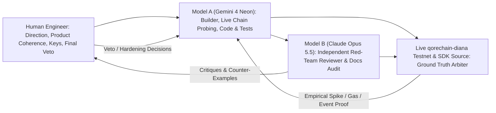

# AI Usage — Attenua

> Living engineering record for the **Best AI-Native Build** award. Every claim below links to an inspectable file, git commit, test suite, or `qorechain-diana` transaction hash. No claim is left unverified.

## AI-Native Engineering Scorecard

| Signal | Verified Evidence in Repo & On-Chain |
|---|---|
| **Multi-Model Adversarial Loop** | `Model A (Gemini 4 Neon)` builder/prober + `Model B (Claude Opus 5.5)` independent red-team reviewer with separate context |
| **Isolated Subagent Specialization** | Dedicated zero-context Blind Red-Team subagent (`docs/ai/BLIND_RED_TEAM.md`) + live Browser Visual/Console Verifier subagents |
| **Concrete AI Mistakes Caught & Fixed** | **16 documented catches** across pre-code design, gas/EVM quirks, browser UI/RPC resilience, and smart-contract security ([`docs/ai/MISTAKES_AND_CATCHES.md`](docs/ai/MISTAKES_AND_CATCHES.md)) |
| **Critical Vulnerabilities Found by AI Audit** | **3 High (`H-01..H-03`), 1 Medium (`M-03`), 1 Low (`L-04`)** patched & redeployed in `AttenuaVault` v1.1 (`0xf585...af58`) + live Attack `A10` |
| **Trustless Verification Gates** | `4/4` contracts Hallmark **`full match`** (`c68b5b5`) · `19/19` keyless chain checks (`npm run verify`) · `7/7` automated suites + `200` fuzz runs (`npm test`) |
| **AI Agents Inside the Product** | Read-only `@modelcontextprotocol/sdk` MCP server (`agent/src/mcp-server.ts`) + zero-budget `Research` prompt-injection screener (`docs/ai/AGENT_SESSION.md`) |

---

## 1. Workflow: Human-Directed Cross-Model Adversarial Engineering

Rather than relying on a single AI model checking its own work, **Attenua** is built using a **Human + Dual-Model Adversarial Loop**:

- **Model A (Gemini 4 Neon)** reads QoreChain documentation and kit sources, queries live `qorechain-diana` REST/RPC endpoints, proposes architecture, drafts Solidity/TypeScript code, runs verification scripts, and orchestrates specialized subagents.
- **Model B (Claude Opus 5.5)** (an independent model family with no shared chat history) audits every architectural claim against QoreChain's live documentation, SDK `.d.ts` definitions, and `@qorechain/asset-kit` Solidity source code to hunt for trust-model flaws, misquoted specs, and hidden classical-key gaps.
- **Ground Truth Arbiter**: Disagreements between models are never settled by prose — every protocol assumption is verified directly against live `qorechain-diana` transactions (Step 0 Spike) and installed SDK types.
- **Human Engineer**: Owns product direction, real-world coherence, key custody (throwaway testnet keys kept outside the repository in `~/.config/attenua-spike/`), faucet funding, registration, hackathon decisions, and final release approvals.

---

## 2. Two Separate Roles of AI in Attenua

1. **AI Building Attenua** (this document + `docs/ai/`):
   - Protocol verification against live `qorechain-diana` endpoints, SDK types, and `@qorechain/asset-kit` source & licence files.
   - Adversarial architecture review (`docs/ai/DECISION_LOG.md`) and 16-item error-catching log (`docs/ai/MISTAKES_AND_CATCHES.md`).
   - Step 0 Testnet Spike (`docs/SPIKE_RESULTS.md`), Solidity contracts (`AttenuaVault` v1.1), automated unit/property/live-invariant tests ([`agent/test/attenua.test.ts`](agent/test/attenua.test.ts)), and a zero-context blind AI red-team audit ([`docs/ai/BLIND_RED_TEAM.md`](docs/ai/BLIND_RED_TEAM.md)).
   - Automated live browser UI/RPC verification + 2K demo video rendering & 73-frame visual critique via Unveo (`unveo.dev` workflow).
2. **AI Running Inside Attenua** (runtime agents):
   - **Orchestrator Agent**: Treasury desk coordinator reading live chain state and research briefs, drawing JIT working capital inside `x/abstractaccount` bounds, and issuing strictly attenuated `ML-DSA-87` sub-mandates.
   - **Research Sub-Agent (Zero-Budget)**: Uses Attenua's read-only MCP tool server ([`agent/src/mcp-server.ts`](agent/src/mcp-server.ts)) and prompt screener ([`agent/src/research-screener.ts`](agent/src/research-screener.ts)) to inspect Diana state and screen unstructured vendor invoices for prompt injections and anomalies, signing structured `ML-DSA-87` clearance verdicts while being cryptographically incapable of spending `1 uqor`.
   - Live screener session transcript facing prompt-injected invoices is recorded in [`docs/ai/AGENT_SESSION.md`](docs/ai/AGENT_SESSION.md).

---

## 3. Verification Discipline (How We Prevent AI Hallucinations)

1. **SDK Source Over Memory**: Every precompile address, spender-limit flag, and RPC URL is read directly from installed `@qorechain/sdk` `.d.ts`/dist files and QoreChain docs before coding (catching the non-existent per-key binding API in #9 and wrong RPC hostnames in #13).
2. **Step 0 Empirical Spike Before Spec**: Zero production Solidity was frozen until `S1–S8` executed on `SpikeProbe` (`0xe4bf5d52d9ea33fcf3515ae3ee55841df847c626`, block `10513230`).
3. **Zero-Context Blind Security Audit**: A fresh-context subagent received only contract & agent code — no design rationale — uncovering `H-01`, `H-02`, `H-03`, `M-03`, and `L-04` before v1.1 freeze.
4. **Live Browser & Keyless Regression Gates**: Every frontend and chain-ops edit must pass `npm run typecheck`, `npm test`, headless browser console/RPC verification, and `npm run verify` (`19/19`) after the final edit.

---

## 4. Human vs. AI Responsibility Matrix

| Area | AI Contribution — `Gemini 4 Neon`, `Claude Opus 5.5` & Specialized Subagents | Human Engineer Contribution |
|---|---|---|
| Architecture & threat modeling | Explored candidate concepts; cross-examined trust models, oracle dependencies, and post-quantum threat horizons | Enforced product-market coherence and ethical standards; rejected concepts with weak trust models; selected *Attenua* institutional treasury architecture |
| Protocol & kit verification | Queried live `api-testnet.qore.host`, inspected `@qorechain/sdk` types and `@qorechain/asset-kit` source/licences | Verified findings independently, resolved conflicting model claims, enforced "Step 0 Spike before final spec" rule |
| Smart contracts, verification & tests | Drafted `SpikeProbe.sol`, `AttenuaVault.sol` (v1.1), 200-run property/fuzz checks (`agent/test/attenua.test.ts`), Hallmark claim script (`agent/src/05-claim-hallmark.ts`), and blind audit (`docs/ai/BLIND_RED_TEAM.md`) | Reviewed all security invariants, approved scoped EVM window operations, deployments, and commits |
| Dashboard, keys & fest submission | Implemented Figma design tokens in `web/`, fixed SVG connector geometry and testnet RPC throttling (`bda98f8`), and automated 2K demo script/capture/frame-critique via Unveo | Funded throwaway accounts via faucet, connected QoreX/GitHub/Figma, reviewed & approved demo narration/pace/background (`unveo.dev`), and submitted on `build.qorechain.io` |

---

## 5. Documented AI Mistakes & How Cross-Model Review Caught Them

Full evidence and diffs live in [`docs/ai/DECISION_LOG.md`](docs/ai/DECISION_LOG.md) and [`docs/ai/MISTAKES_AND_CATCHES.md`](docs/ai/MISTAKES_AND_CATCHES.md).

| # | AI Error / Blind Spot | Caught By | Resolution |
|---|---|---|---|
| 1 | Proposed external HTTPS APIs wrapped in self-held ML-DSA keys (*AegisPulse*) as a "BFT sensor quorum" | Model B + Human | Abandoned idea; adopted zero-fake-oracle rule |
| 2 | Proposed classical cached session keys under an ML-DSA root (*SubLeash* v1), weakening Q-Day posture | Model B | Replaced with per-action `ML-DSA-87` verification (~200–313k gas) + cached parent delegation hash only |
| 3 | Misquoted v3.2.2 docs to propose `pullJIT` (`transferFrom` via standing ERC-20 `allowance`), bypassing `x/abstractaccount` limits on vault bug | Model B | Dropped `pullJIT` / standing `allowance`; switched to direct `fUSD.transfer(AttenuaVault, x)` bounded by `denom_limits` |
| 4 | Missed `QoreChainHybridHolderGuard` (`Ownable2Step`) classical `onlyOwner` on `setExempt(AttenuaVault)` | Model B (reading `asset-kit` source) | Renounced guard ownership cleanly (`0x0000...0000`) immediately after `setExempt(AttenuaVault)` inside scoped window |
| 5 | Missed GPL-3.0 licence on `asset-kit`'s `contracts/script/erc3643/` & `test/erc3643/` vs MIT/Apache-2.0 rule | Model A (reading `asset-kit` README) | Restricted imports strictly to Apache-2.0 files (`contracts/src/` guards & ERC-4626 vaults) |
| 6 | Suggested calling `aiAnomalyCheck` (`0x...0b02`) as an on-chain tripwire | Model A (live curl to `/cosmos/evm/vm/v1/params`) | Removed `0x...0b02` (inactive on Diana; returns empty `0x`) and added fail-closed length checks on `0x...0a01` & `0x...0a02` |
| 7 | Claimed `allowed_evm_calls` selector filtering did not exist in docs | Model A (live docs read) + Model B re-verification | Confirmed v3.2.2 selector syntax `0x<target>/0x<selector>` in Account Abstraction docs; verified in Spike **S3** |
| 8 | Assumed a bare classical EOA monitor could call `freeze()` directly on EVM, and did not forbid `msg.sender` auth under `MsgExecuteEVM` | Model B | Moved Monitor to a linked `x/abstractaccount` authenticator (`allowed_evm_calls: [freeze]`) + enforced zero `msg.sender` trust in `AttenuaVault.sol` |
| 9 | Planned to attach both Orchestrator and Monitor to the same abstract account with separate per-key rules | Model A (reading `@qorechain/sdk` v0.14.0 `index.d.ts`) + Model B | SDK v0.14.0 lacks per-key rule binding; isolated Monitor onto dedicated AA #2 (`0 fUSD`), locked Owner to **1 linked key**, verified in Spike **S8** |
| 10 | Initial `02-run-swarm-and-attacks.ts` logged `A3`/`A5`/`A6` reverts as passes when `evmGasLimit` tripped EIP-7623 calldata floor (`0` gas used) | Model A manual evidence inspection | Raised `evmGasLimit` to `1,200,000` and asserted non-zero EVM gas + non-OOG reasons in `02-run-swarm-and-attacks.ts` & `03-verify.ts` |
| 11 | `x/abstractaccount` spend probe consumed ~380k+ extra Cosmos gas when checking `erc20/<fUSD>` deltas | Live testnet execution log | Allocated `cosmosGas = evmGasLimit + 700,000` in `relayCall` (`docs/HONEST_LIMITS.md`) |
| 12 | `evmVersion: "paris"` broke OpenZeppelin v5 `mcopy` & PowerShell UTF-8 BOM broke `solc` | `solc 0.8.28` build error | Switched to `evmVersion: "cancun"` + stripped BOMs |
| 13 | Hardcoded non-SDK testnet hostnames (`evm-diana.qorechain.io`) stalled browser live RPC badge | Live curl & `@qorechain/sdk` dist check | Switched `web/src/lib/chain.ts` to canonical `https://evm-testnet.qore.host` (`c438cd0`) |
| 14 | `AttenuaVault` v1.0 allowed depth-1 zero-budget self-delegation (`H-01`), premature parent reclaim (`H-02`), and immutable freeze trap (`H-03`) | Zero-context Blind Audit subagent (`BLIND_RED_TEAM.md`) | Fixed all 3 High + `M-03` + `L-04` in `AttenuaVault` v1.1, added live Attack `A10`, verified `19/19` |
| 15 | Concurrent 6-call browser RPC batches triggered HTTP `503` on `evm-testnet.qore.host`, REST calls hit CORS/`501`, plus 3-way tree SVG & EIP-6963 UX gaps | Browser Verifier subagent + live console inspection | Removed CORS-failing REST fetches, added `runInPairs` throttling + short cache (`bda98f8`, `1a7d853`), aligned SVGs & added EIP-6963 (`0cfa684`) |
| 16 | Unveo J-cut negative `lead_s` crashed `ffmpeg` `adelay`, calm `-10%` pace ran `3.87s` over `180s`, and `s02.4` `1.35×` zoom cropped `.subagents-grid` | Automated Unveo `frames.py` & `qa.py` gates | Fixed negative `adelay` handling in preview stitching, tightened 3 scene lines to `2:49.6`, moved `s02.4` zoom to `Payables` card (`73/73` frames ≥ 8/10, all blocking QA gates PASS) |

---

## 6. Living Log (Updated Through Final Submission)

- **2026-11-22 — Step 0 Empirical Testnet Spike (`0aaa528`, `docs/SPIKE_RESULTS.md`)**: Compiled & deployed `SpikeProbe.sol` (`0xe4bf5d52d9ea33fcf3515ae3ee55841df847c626`, block `10513230`) and passed **S1–S8 (8/8)** on `qorechain-diana`.
- **2026-11-22 — Phase 1–2 Live Deployment, 3-Sub-Agent Swarm & Attacks (`7cc5915`, `deployments/qorechain-diana.json`)**: Deployed all 4 contracts (`solc 0.8.28`, `viaIR`, `cancun`), renounced `HolderGuard`, executed `H1–H7` and `A1–A9` (EIP-7623 calldata floor caught in #10).
- **2026-11-22 — Phase 3–4 Web Dashboard, Figma System, Blind Audit & v1.1 Hardening (`3085dff`, `79d02c4`, `c438cd0`)**: Implemented user's Figma design system, added keyless QoreX/HolderGuard inspector, ran zero-context blind audit (`H-01..H-03`), redeployed `AttenuaVault` v1.1 (`0xf585...af58`) with Attack `A10`, captured `Research` MCP session (`docs/ai/AGENT_SESSION.md`), and passed `npm test` (`7/7`, `200` fuzz runs) + `npm run verify` (`19/19`).
- **2026-11-22 — Hallmark Source Verification, Adaptive Favicons & Browser/RPC Hardening (`bec7d73`, `0cfa684`, `c68b5b5`, `655bacb`, `bda98f8`, `1a7d853`)**: Designed 16:9 Figma cover & theme-adaptive SVG favicons; verified and `ML-DSA-87` claimed **4/4** contracts (`full match`, `PQ-guarded`) to `https://github.com/agvswira/attenua` inside a strictly closed scoped EVM window (`agent/src/05-claim-hallmark.ts`); fixed SVG bus/timeline continuity, EIP-6963 wallet connection & QoreChain Diana switch (`0x2648`), and eliminated `evm-testnet.qore.host` HTTP `503` bursts with pairwise RPC throttling (`web/src/lib/chain.ts`).
- **2026-11-22 — Automated 2K Demo Production & Final Repo Hygiene**: Produced a `2:49.6` (`2560×1440`, `-14.0 LUFS`, `0` pops, `0` console errors, `0` dead stretches) demo video via Unveo with custom `1280×720` cover thumbnail, audited `README.md`, `AI_USAGE.md`, and `.gitignore` (`unveo-out/` excluded), and re-verified `npm run verify` (`19/19`), `npm test` (`7/7`), and `web` production build.
