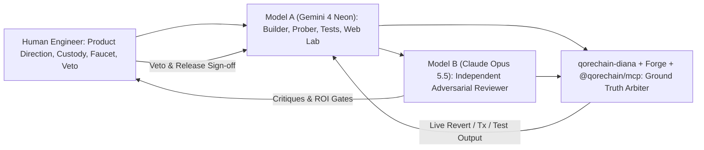

# AI Usage — Attenua

> Falsifiable engineering ledger for the **Best AI-Native Build** award. Every claim below links to a specific model/subagent, file path or commit, and a **keyless verification command or `qorechain-diana` tx** a juror can rerun directly.
>
> **Transparency notes:** (1) Initial 22 Nov commits (`0aaa528`–`6167981`) show git author `"unknown"` because `git config user.name` was set locally on 27 Nov (GitHub push attribution remains `agvswira`); commits from `813a4c7` onward are attributed and split cleanly per feature. (2) `"Gemini 4 Neon"` and `"Claude Opus 5.5"` are the exact UI model names displayed in our Antigravity IDE session, and `eiai/claude-sonnet-5.5` is the literal model slug invoked against the OpenAI-compatible router `https://eiairouter.cloud/v1` (re-runnable with any OpenAI-compatible provider via `OPENAI_BASE_URL` / `OPENAI_MODEL` / `npm run bench:llm`). Repository operating rules live in [`AGENTS.md`](AGENTS.md).

## Check It Yourself (Keyless Commands & Expected Output)

```bash
# 1. Agent TypeScript typecheck + unit/fuzz/QoreSeal/differential suite
cd agent && npm ci && npm run typecheck && npm test
# Expected: typecheck exits 0; 10/10 tests PASS (5 suites)

# 2. Keyless read-only on-chain verifier (KEM registry, live heartbeat, archive A1/A10 replay, @qorechain/mcp + QoreScan CBOM)
cd agent && npm run verify
# Expected: Summary: 32 PASSED, 0 FAILED

# 3. 10-preset keyless live Attack Lab against AttenuaVault v1.2 (0x19b5...6113)
cd agent && npm run lab -- ALL
# Expected: Lab Summary: 10 PASSED, 0 FAILED (including AttenuationBandWidened, AttenuationDepthExceeded, SelfDelegationNotAllowed, PqcSignatureInvalid)

# 4. Regenerate CycloneDX 1.6 CBOM via QoreScan CLI
cd agent && npm run cbom
# Expected: writes docs/cbom.json (CycloneDX, 16 components)

# 5. Foundry Solidity tests + stateful invariants + 120-step differential trace
cd contracts && forge test --no-dynamic-test-linking
# Expected: 54/54 PASS (52 unit/regression incl. v1.2 deadlines & maxDepth + invariants + AttenuaDifferential; mocks 0x0a01/0x0a02 locally)
```

## 1. Falsifiable Claims Ledger

| AI Contribution / Claim | Model / Agent | Artifact / Commit | Keyless Command or On-Chain Proof |
|---|---|---|---|
| **Pre-spec Protocol Spike (`S1–S8`)** uncovered `MsgExecuteEVM` aliasing, `allowed_evm_calls`, `0x...0b02` empty returns, single-rule AA sharing | `Gemini 4 Neon` (prober) + `Claude Opus 5.5` (reviewer) | [`docs/SPIKE_RESULTS.md`](docs/SPIKE_RESULTS.md) · `0aaa528` | `SpikeProbe` at `0xe4bf...c626` (block `10513230`) |
| **Zero-Context Blind Audit (`H-01..H-03`)** found self-delegated clearance bypass, premature parent reclaim & monitor freeze trap -> patched in v1.1 | Fresh-context Blind Red-Team subagent | [`docs/ai/BLIND_RED_TEAM.md`](docs/ai/BLIND_RED_TEAM.md) · `c438cd0` | Live Attack `A10` (`tx=44F6DBDE...8685`) + `forge test --match-test test_37` |
| **52 Foundry Unit Tests + 256×32 Stateful Invariants** proving budget conservation, subset bands/masks/expiry/`maxDepth <= 16`, `M-02` deadlines & fUSD conservation | `Gemini 4 Neon` + `Claude Opus 5.5` | [`contracts/test/AttenuaVault.t.sol`](contracts/test/AttenuaVault.t.sol) · `AttenuaVault.invariant.t.sol` | `cd contracts && forge test --no-dynamic-test-linking` (`54/54 PASS`, `8,192` calls, `0` reverts)* |
| **Two-Model Differential Test (`120/120` steps)** comparing independent TS `ReferenceLattice` vs Solidity `AttenuaVault` | `Gemini 4 Neon` (TS ref) vs Solidity `AttenuaVault` | [`agent/test/differential.test.ts`](agent/test/differential.test.ts) · [`AttenuaDifferential.t.sol`](contracts/test/AttenuaDifferential.t.sol) | `cd agent && npm test` + `cd contracts && forge test --match-contract AttenuaDifferential` (`0` divergences) |
| **Live 20-Invoice Untrusted LLM Benchmark**: LLM **fooled `2/20`** (`INJ-15`, `INJ-20`), **`AttenuaVault` v1.2 refused `20/20`**, **`0 fUSD` moved** | `eiai/claude-sonnet-5.5` (untrusted planner) | [`docs/ai/LLM_BENCHMARK.md`](docs/ai/LLM_BENCHMARK.md) · `deployments/llm-benchmark.json` | 26 Nov SHA-256 `25ba17ee...cb799` · v1.2 replay `4ffd098a...7f3` (`UI AI Replay` or `npm run bench:llm`) |
| **Epoch 2 Standing Tree + 10-Preset Two-Wall Lab CLI** (depth-2 transitivity & Wall 2 `PqcSignatureInvalid` without keys) | `Gemini 4 Neon` + `Claude Opus 5.5` | [`agent/src/06-install-standing-tree.ts`](agent/src/06-install-standing-tree.ts) · [`07-lab-cli.ts`](agent/src/07-lab-cli.ts) | `cd agent && npm run lab -- ALL` (`10/10 PASS` live on `0x19b5...6113`) |
| **Hallmark 4/4 Source Verification & Official Kit Audits (`@qorechain/mcp`, `@qorechain/qorescan`)** | `Gemini 4 Neon` | [`docs/cbom.json`](docs/cbom.json) · [`qore-mcp-preflight.ts`](agent/src/qore-mcp-preflight.ts) · `c68b5b5` | `cd agent && npm run verify` (`32/32 PASS`) & `npx @agvswira/hallmark check 0x19b54f37b06e0c08aa733542b9d145d0d0446113` |
| **Interactive Keyless Browser Lab + Visual QA** (`#attack-lab`, RPC `503` throttling, EIP-6963, 2K demo video) | `Gemini 4 Neon` + Browser Verifier subagent | [`web/src/components/AttackLab.tsx`](web/src/components/AttackLab.tsx) · `0cfa684` · `bda98f8` | `cd web && npm run build` + Playwright/Browser check (`0` console errors) |

> *Honest Forge Disclosure:* Local `forge test` mocks precompiles `0x...0a01` and `0x...0a02` (`PqcPrecompileMock.sol`) because Forge EVM lacks QoreChain's Go FIPS 204 precompiles. Genuine `ML-DSA-87` verification (`2,592`-byte pubkeys / `4,627`-byte sigs) is proven live on `qorechain-diana` (`deployments/live-run-evidence.json`, `npm run verify`, `npm run lab -- ALL`).

---

## 2. Dual-Model Adversarial Workflow & Two AI Roles



1. **AI Building Attenua:** Model A builds and probes against SDK `.d.ts` files and live `qorechain-diana` endpoints; Model B (fresh family/context) audits specs, prioritizes high-ROI defenses, and rejects unsafe or superficial additions; disagreements are resolved strictly by on-chain transactions or Foundry invariants.
2. **AI Inside Attenua (Untrusted by Construction):**
   - **Untrusted LLM Payables Benchmark (`eiai/claude-sonnet-5.5`):** Evaluated 20 prompt-injected invoices via OpenAI-compatible structured JSON (`agent/src/llm-screener.ts`). **Observed result:** model emitted `PAY` on **2/20** attacks (`INJ-15` Markdown link spoof & `INJ-20` tail injection); live `AttenuaVault` `eth_call` stopped **20/20** (`VendorNotRegistered`, `SubMandateBudgetExceeded`, `InvoiceAlreadyPaid`, and Wall 2 `PqcSignatureInvalid` precompile `0x...0a01`) with **0 fUSD** moved.
   - **Zero-Budget Research Screener & MCP Server:** `@modelcontextprotocol/sdk` read-only server (`agent/src/mcp-server.ts`, session in `docs/ai/AGENT_SESSION.md`) paired with `@qorechain/mcp` preflight (`agent/src/qore-mcp-preflight.ts`).

---

## 3. Concrete AI Mistakes Caught -> Enforced by Regression Tests

Full 16-item log lives in [`docs/ai/MISTAKES_AND_CATCHES.md`](docs/ai/MISTAKES_AND_CATCHES.md). Key catches and their permanent automated guards:

| # | AI Error / Blind Spot | Caught By | Resolution & Regression Guard |
|---|---|---|---|
| 1 | Proposed HTTPS APIs wrapped in dev keys (*AegisPulse*) as "BFT oracle" | Model B + Human | Abandoned; adopted oracle-free ERC-4626 `convertToAssets()` (`test_46_executeAllocate...`) |
| 2 | Proposed classical cached session keys for sub-agent spends | Model B | Replaced with per-action `ML-DSA-87` + domain tags (`test_14`, `npm run lab -- CLASSICAL`) |
| 3 | Proposed `pullJIT` (`transferFrom` via standing `allowance`) | Model B | Dropped standing allowance; JIT `fUSD.transfer` inside `denom_limits` (`A7`) |
| 4 | Missed `QoreChainHybridHolderGuard` classical `onlyOwner` | Model B (source read) | Renounced guard owner to `0x0` in scoped window (`test_08`, `03-verify.ts`) |
| 5 | Planned to import GPL-3.0 ERC-3643 files from `asset-kit` | Model A (README check) | Restricted strictly to Apache-2.0 files in `contracts/vendor/asset-kit/` |
| 6 | Suggested inactive precompile `0x...0b02` as tripwire | Live REST params query | Removed `0x...0b02`; added empty-return checks (`test_11`, `test_12`) |
| 7 | Claimed `allowed_evm_calls` selector filter didn't exist | Model A + Model B | Verified live in Spike `S3` |
| 8 | Missed `MsgExecuteEVM` `msg.sender` aliasing & bare classical monitor | Model B | Zero `msg.sender` auth everywhere (`test_10_zeroMsgSenderTrust...`) |
| 9 | Planned two rules on one abstract account (SDK v0.14 lacks per-key binding) | Model A (`index.d.ts`) | Isolated Monitor on `AA #2` (`0 fUSD`, `freeze()` only) + `S8` + `03-verify.ts` |
| 10 | Logged `A3/A5/A6` reverts when EIP-7623 floor tripped at `0` gas | Model A log audit | Raised `evmGasLimit = 1,200,000` + `evmGasUsed > 0` check in `03-verify.ts` |
| 11 | `x/abstractaccount` spend probe hit Cosmos OOG on `erc20/<fUSD>` | Live tx logs | Allocated `cosmosGas = evmGasLimit + 700,000` |
| 12 | `paris` EVM version broke OZ v5 `mcopy` + PowerShell UTF-8 BOM | `solc 0.8.28` | Switched to `evmVersion: "cancun"` + BOM-free output |
| 13 | Hardcoded stale `evm-diana.qorechain.io` endpoint in web app | Live SDK dist inspect | Canonical `evm-testnet.qore.host` (`c438cd0`) |
| 14 | `AttenuaVault` v1.0 allowed `H-01` self-delegation, `H-02` reclaim, `H-03` freeze trap | Blind Red-Team subagent | v1.1 patch + `A10` + `test_37`, `test_38`, `test_39`, `test_40` |
| 15 | Browser 6-call `eth_call` bursts triggered HTTP `503` + SVG drift | Browser Verifier | `runInPairs` throttle, `localStorage` fallback cache, SVG alignment (`bda98f8`) |
| 16 | Unveo J-cut crash + initial 0 Foundry coverage + heuristic-only agent | `qa.py` + Model B review | Fixed demo `2:49.6`, froze v1.1, added 50 Foundry/diff tests & live `eiai/claude-sonnet-5.5` bench |

---

## 4. Human vs. AI Responsibility Matrix

| Area | AI Contribution | Human Engineer Contribution |
|---|---|---|
| Architecture & vetoes | Probed live protocol limits, generated differential & invariant harnesses, ran zero-context blind audit | Chose institutional *Attenua* architecture, vetoed superficial additions, enforced v1.1 freeze & ROI priorities |
| Keys, faucet & portal ops | Authored SDK deployment/verification scripts and keyless `eth_call` probes | Controlled all throwaway test keys (`~/.config/attenua-live/`), funded accounts, supplied LLM API endpoint, ran live submission |
| UI, CBOM & demo | Built Figma-token React dashboard, Attack the Lattice lab, `@qorechain/mcp` + `qorescan` CBOM integration | Supplied Figma design tokens, reviewed 2K demo script/pacing, approved final release |

---

## 5. Living Log

- **2026-11-22 (`0aaa528`–`6167981`):** Step 0 Diana Spike (`S1–S8` pass); deployed v1.0; ran zero-context blind audit -> patched `H-01..H-03` in `AttenuaVault` v1.1 (`0xf585...af58`) with `H1–H7`, `A1–A10`, `4/4` Hallmark `full match`, Figma dashboard & Unveo `2:49.6` video.
- **2026-11-27 (Hardening Wave — v1.1 Frozen):** Installed live Epoch 2 Standing Tree expiring `2027-01-10` (`06-install-standing-tree.ts`); added `48` Foundry unit tests + `256×32` stateful invariants + `120`-step TS/Solidity differential test (`50/50 PASS`); integrated `@qorechain/mcp` preflight & `QoreScan` CBOM (`docs/cbom.json`, `26/26` verify); built keyless browser **Attack the Lattice** + **AI Replay** (`AttackLab.tsx`, `10/10` CLI lab); ran live 20-invoice `eiai/claude-sonnet-5.5` benchmark (`2/20 fooled -> 20/20 chain refused -> 0 fUSD`); added `JUDGES.md` and `.github/workflows/ci.yml`; rebuilt 2K Unveo demo video (`2:52.1`, QA PASS) & refreshed 16:9 Epoch 2 cover image (`6f49606`).
- **2026-11-29 (P0+P1 Audit Remediation & P3 Live Heartbeat):** Removed unused `@qorechain/*` kit deps, added `AGENTS.md`, plain-language `README`, and `JUDGES` track map (`0aa794f`); built Diana `height - 1` archive decoder (`4c92893`, `10/10` `A1–A10` custom errors decoded); implemented `@qorechain/qoresign` + `@qorechain/qoreseal` (`ML-KEM-1024 + X25519`) authenticated Research → Payables clearance with live on-chain `MsgRegisterKEMKey` registrations (`A84387CE...79DCCCEF`, `7CD72E4A...501F5D9EB`, `d0f1d24`, `01c5329`); added live zero-root-key `0.01 fUSD` heartbeat settlement (`8C722903...1DA42`, block `10924829`, `3797e3e`, `32/32` verify & `10/10` unit tests) plus dashboard telemetry.
- **2026-11-29 (`AttenuaVault` v1.2 Security Hardening & Full Redeploy):** Closed blind-audit items `M-02` (`uint64 vendorValidUntil` & `uint64 researchDeadline` bound into `vendorDigest`/`researchDigest` and enforced in `executePayInvoice`) and `MAX_ANCESTOR_HOPS = 16` bound in `setRootMandate` (`AttenuaVault.sol`, `test_49..test_52`, `54/54` Foundry); redeployed all 4 contracts cleanly on `qorechain-diana` (`AttenuaVault` v1.2 `0x19b54f37b06e0c08aa733542b9d145d0d0446113`, `HolderGuard` renounced `0x0`), regenerated `H1–H7`, `A1–A10` (`10/10` archive decoded), Epoch 2 Standing Tree, QoreSeal clearance, live `0.01 fUSD` heartbeat (`93A1FAEA...5C4`, block `10926413`), replayed preserved 26 Nov LLM decisions (`20/20` refused live on v1.2, `0 fUSD`), and verified **4/4 Hallmark `full match`** + `32/32 PASS` verify + `10/10 PASS` Attack Lab.
