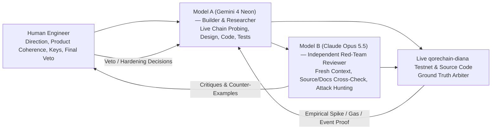

# AI Usage — Attenua

> Living engineering record for the **Best AI-Native Build** award. Every claim below links to an inspectable file, test, commit, or `qorechain-diana` transaction hash. No claim is left unverified.

## 1. Workflow: Human-Directed Cross-Model Adversarial Engineering

Rather than relying on a single AI model checking its own work, **Attenua** is built using a **Human + Dual-Model Adversarial Loop**:

- **Model A (Gemini 4 Neon)** reads QoreChain documentation and kit sources, queries live `qorechain-diana` REST/RPC endpoints, proposes architecture, drafts Solidity/TypeScript code, and runs verification scripts.
- **Model B (Claude Opus 5.5)** (an independent model family with no shared chat history) audits every architectural claim against QoreChain's live documentation, SDK `.d.ts` definitions, and `qorechain-asset-kit` Solidity source code to hunt for trust-model flaws, misquoted specs, and hidden classical-key gaps.
- **Ground Truth Arbiter**: Disagreements between models are never settled by prose — every protocol assumption is verified directly against live `qorechain-diana` transactions (Step 0 Spike) and installed SDK types.
- **Human Engineer**: Owns product direction, real-world coherence, key custody (throwaway testnet keys stored outside the repository), faucet funding, registration, final go/no-go calls, and all public releases.

---

## 2. Two Separate Roles of AI in Attenua

1. **AI Building Attenua** (this document + `docs/ai/`):
   - Protocol verification against live `qorechain-diana` endpoints, SDK types, and `qorechain-asset-kit` source & licence files.
   - Adversarial architecture review (`docs/ai/DECISION_LOG.md`) and error-catching log (`docs/ai/MISTAKES_AND_CATCHES.md`).
   - Step 0 Testnet Spike (`docs/SPIKE_RESULTS.md`), Solidity contracts, unit/fuzz/invariant/mutation test suites, and a blind post-freeze AI red-team audit (`docs/ai/BLIND_RED_TEAM.md`, to be executed once MVP contracts freeze).
2. **AI Running Inside Attenua** (runtime agents):
   - **Orchestrator Agent**: Treasury desk coordinator reading live chain state and research briefs, drawing JIT working capital inside `x/abstractaccount` bounds, and issuing strictly attenuated `ML-DSA-87` sub-mandates.
   - **Research Sub-Agent (Zero-Budget)**: Uses `@qorechain/mcp` (read-only) to inspect Diana state and screen unstructured vendor invoices for prompt injections and anomalies, signing structured clearance verdicts without ever being capable of spending `1 uqor`.
   - Runtime transcripts of real LLM sessions facing live prompt-injected invoices will be recorded in `docs/ai/AGENT_SESSION.md`.

---

## 3. Human vs. AI Responsibility Matrix

| Area | AI Contribution — Model A (`Gemini 4 Neon`) & Model B (`Claude Opus 5.5`) | Human Engineer Contribution |
|---|---|---|
| Architecture & threat modeling | Explored candidate concepts; cross-examined trust models, oracle dependencies, and post-quantum threat horizons | Enforced product-market coherence and ethical standards; rejected concepts with weak trust models or disproportionate scope; selected the *Attenua* + institutional treasury fusion |
| Protocol & kit verification | Queried live `api-testnet.qore.host`, inspected `@qorechain/sdk` types and `qorechain-asset-kit` source/licences | Verified findings independently, resolved conflicting model claims, enforced "Step 0 Spike before final spec" rule |
| Smart contracts & tests | Drafted `SpikeProbe.sol`, `AttenuaVault.sol`, tests, fuzz/invariant/mutation suites *(in progress)* | Reviews all security invariants, approves deployments and public commits |
| Keys, faucet, & fest submission | Generates scripts that keep throwaway keys outside the repo (`~/.config/attenua-spike/`) | Funds throwaway testnet accounts via faucet, connects QoreX/GitHub/X, records demo video |

---

## 4. Documented AI Mistakes & How Cross-Model Review Caught Them (Before Writing Production Code)

Full details with evidence live in [`docs/ai/DECISION_LOG.md`](docs/ai/DECISION_LOG.md) and [`docs/ai/MISTAKES_AND_CATCHES.md`](docs/ai/MISTAKES_AND_CATCHES.md).

| # | AI Error / Blind Spot | Caught By | Resolution |
|---|---|---|---|
| 1 | Proposed external HTTPS APIs wrapped in self-held ML-DSA keys (*AegisPulse*) as a "BFT sensor quorum" | Model B + Human | Abandoned idea; adopted zero-fake-oracle rule |
| 2 | Proposed classical cached session keys under an ML-DSA root (*SubLeash* v1), weakening Q-Day posture | Model B | Replaced with per-action `ML-DSA-87` verification (~200–313k gas) + cached parent delegation hash only |
| 3 | Misquoted v3.2.2 docs to propose `pullJIT` (`transferFrom` via standing ERC-20 `allowance`), which would bypass `x/abstractaccount` limits if the vault had a bug | Model B | Dropped `pullJIT` / standing `allowance`; switched to direct `fUSD.transfer(AttenuaVault, x)` bounded by `denom_limits` |
| 4 | Missed `QoreChainHybridHolderGuard` (`Ownable2Step`) classical `onlyOwner` on `setExempt(AttenuaVault)` | Model B (reading `asset-kit` source) | Transfer guard ownership to an `ML-DSA-87`-gated admin (or renounce after `setExempt`) |
| 5 | Missed GPL-3.0 licence on `asset-kit`'s `contracts/script/erc3643/` & `test/erc3643/` vs MIT/Apache-2.0 rule | Model A (reading `asset-kit` README) | Restricted imports strictly to Apache-2.0 files (`contracts/src/` guards & ERC-4626 vaults) |
| 6 | Suggested calling `aiAnomalyCheck` (`0x...0b02`) as an on-chain tripwire | Model A (live curl to `/cosmos/evm/vm/v1/params`) | Removed `0x...0b02` (inactive on Diana; returns empty `0x`) and added fail-closed length checks on `0x...0a01` & `0x...0a02` |
| 7 | Claimed `allowed_evm_calls` selector filtering did not exist in docs | Model A (live docs read) + Model B re-verification | Confirmed v3.2.2 selector syntax `0x<target>/0x<selector>` in Account Abstraction docs; queued empirical test S3 in Step 0 Spike |
| 8 | Assumed a bare classical EOA monitor could call `freeze()` directly on EVM, and did not forbid `msg.sender` auth under `MsgExecuteEVM` | Model B | Moved Monitor to a linked `x/abstractaccount` authenticator (`allowed_evm_calls: [freeze]`) + enforced zero `msg.sender` trust inside `AttenuaVault.sol` |
| 9 | Planned to attach both Orchestrator and Monitor to the same abstract account with separate per-key rules | Model A (reading `@qorechain/sdk` v0.14.0 `index.d.ts`) + Model B precision review | Docs mention per-authenticator rules in the resolution order, but SDK v0.14.0 provides no way to bind a rule to a single key; isolated Monitor onto dedicated Abstract Account #2 (`0 fUSD`), locked Owner to **1 linked key (Orchestrator only)**, and added Spike test **S8** |

---

## 5. Living Log (Updated as Milestones Land)

- **2026-11-22 — Step 0 Empirical Testnet Spike (`docs/SPIKE_RESULTS.md`)**: Compiled & deployed `SpikeProbe.sol` on `qorechain-diana` (`0xe4bf5d52d9ea33fcf3515ae3ee55841df847c626`, block `10513230`) and executed **S1–S8 (8/8 PASS)**, proving `msg.sender` aliasing (S1), `denom_limits` ERC-20 capping (S2), `allowed_evm_calls` selector filtering (S3), fail-closed inactive precompiles (S4), live 1×/2×/3× `ML-DSA-87` gas costs (S5), `pqcKeyStatus` (S6), `MsgExecuteEVM` failure decoding (S7), and SDK v0.14 shared account-wide rule behavior (S8).
- **2026-11-22 — Phase 1 Contracts & Live Testnet Deployment (`deployments/qorechain-diana.json`)**: Vendored Apache-2.0 files from `@qorechain/asset-kit` (`QoreChainHybridHolderGuard`, `QoreChainRwaVault`), implemented `PqcVerifier.sol` and `AttenuaVault.sol`, compiled with `solc 0.8.28` (`viaIR`, `cancun`), deployed all 4 contracts live on `qorechain-diana`, renounced `QoreChainHybridHolderGuard` ownership inside a scoped EVM window (`owner = 0x0000...0000`, `window.live = false`), and configured Owner AA #1 (single Orchestrator key) + isolated Monitor AA #2 (`0 fUSD`, `freeze()` only).
- **2026-11-22 — Phase 2 Live 3-Sub-Agent Swarm + 9 Adversarial Attacks (`deployments/live-run-evidence.json`)**: Executed `H1–H7` (Root IPS Mandate, Vendor registration, JIT `fUSD` transfer, `Allocator`/`Payables`/`Research` sub-mandates, ERC-4626 rebalance, 3× atomic `ML-DSA-87` invoice settlement at `673,027` gas, budget reclaim) and `A1–A9` (9/9 on-chain refusals). Caught and fixed an EIP-7623 calldata floor gas false-positive on `A3`/`A5`/`A6` (Catch #10 in `docs/ai/MISTAKES_AND_CATCHES.md`) and hardened `npm run verify` (`agent/src/03-verify.ts`) to assert non-zero EVM gas and non-OOG reasons on every attack.
- **2026-11-22 — Phase 3 Web Dashboard & Read-Only Live Attack Theatre (`web/`)**: Built a zero-key Vite + React + TypeScript dashboard displaying live `qorechain-diana` contract/account state, the hierarchical delegation tree, the `@qorechain/asset-kit` treasury desk, and the `A1–A9` Attack Theatre with a native `<dialog>` evidence inspector, following `modern-web-guidance` (cascade layers, `light-dark()` + fallbacks, `@container` responsive table, accessible landmarks & focus).
- **2026-11-22 — Security Documentation**: Authored [`docs/THREAT_MODEL.md`](docs/THREAT_MODEL.md) and [`docs/HONEST_LIMITS.md`](docs/HONEST_LIMITS.md).
- **2026-11-22 — Figma Design Implementation & Motion Polish (`web/`)**: Implemented the user-authored Figma design (`Overview · Light`, `Overview · Dark`, `Inspector · A5 open`, `Data states`, nested-chevron SVG brand mark & vector connectors) with full `/modern-web-guidance` adherence (smooth scrolling, CSS scroll-progress bar, `view()` scroll reveals, compositor-only transitions, accessible `<dialog>` inspector, and responsive `@container` tables).
