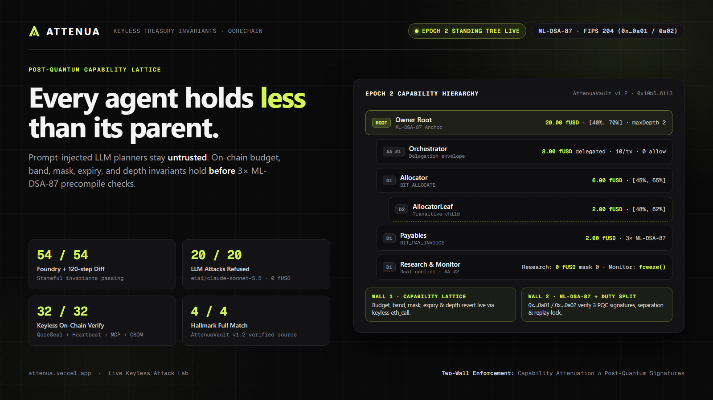
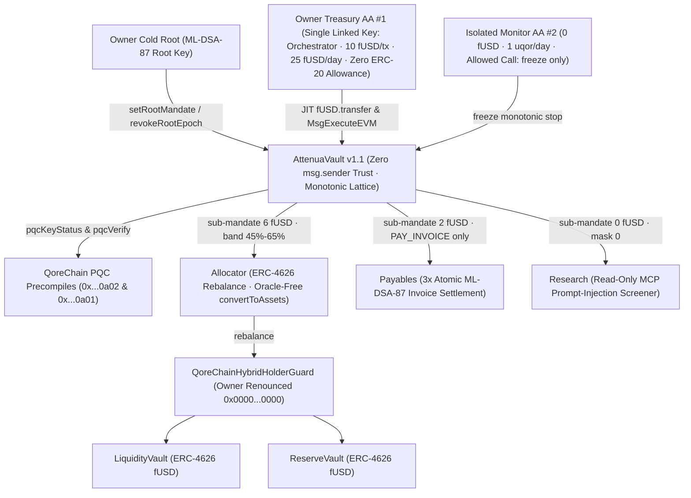

# Attenua



[](https://build.qorechain.io/p/attenua)
[](https://hallmark-jade.vercel.app/c/0xf585fc6e1e43446f353830e0d11ff44ce747af58)
[](LICENSE)
[-10b981.svg)](deployments/qorechain-diana.json)

**Post-Quantum Hierarchical Capability Attenuation for Autonomous Institutional Treasury Swarms on QoreChain.**

> *"Every agent holds less than its parent."*

[Live Dashboard](https://attenua.vercel.app/) · [Hallmark Source Proof](https://hallmark-jade.vercel.app/c/0xf585fc6e1e43446f353830e0d11ff44ce747af58) · [Architecture](#architecture) · [10 Refused Attacks](#live-verified-swarm-h1-h7--10-refused-attacks-a1-a10) · [60s Keyless Verify](#60-second-keyless-verification) · [AI-Native Log](AI_USAGE.md)

---

## Why Attenua?

Production AI treasury desks run an **Orchestrator** that delegates tasks to specialized sub-agents (*Allocator*, *Payables*, *Research*). Under QoreChain's `x/abstractaccount` `MsgExecuteEVM`, every sub-agent relays through the parent account's `0x` origin (`msg.sender` aliasing verified in Step 0 Spike **S1**). Sharing one key lets a prompt-injected sub-agent drain the vault; requiring human owner sign-off on every micro-task destroys autonomy.

| Approach | Autonomy | Blast Radius on Sub-Agent Compromise | Post-Quantum Authorization |
|---|---|---|---|
| **Shared Linked Key** | High | Full account treasury & standing allowances | Broken once delegated key leaks |
| **Cold Owner Sign-Off** | None | Contained, but human bottleneck per action | `ML-DSA-87` per click |
| **Attenua Capability Lattice** | **Full autonomous swarm** | **Capped per child mandate (`Research = 0 fUSD`) + O(1) kill-switch** | **Fail-closed `ML-DSA-87` (`0x...0a02` → `0x...0a01`)** |

**Attenua** brings hierarchical cryptographic capability attenuation (inspired by **UCAN** and **Biscuit**) to QoreChain's post-quantum EVM + Cosmos `x/abstractaccount` stack, managing `fUSD` ERC-4626 treasury vaults (`@qorechain/asset-kit`, Apache-2.0 components only).

---

## Architecture



### Core Guarantees

1. **Zero `msg.sender` Trust & Fail-Closed PQC (`AttenuaVault.sol`, `PqcVerifier.sol`)**
   No `onlyOwner` or `msg.sender` authorization anywhere. Every spend, delegation, vendor update, or emergency loosen verifies domain-separated `ML-DSA-87` signatures through `PqcVerifier` (`pqcKeyStatus` at `0x...0a02` requiring `possessionProven == true`, followed by `pqcVerify` at `0x...0a01`).
2. **Monotonic Capability Lattice (5 On-Chain Invariants)**
   `registerSubMandate()` checks child budget conservation ($\sum \text{child} + \text{parent} \le \text{root}$), narrowed allocation band (`[childMinBps, childMaxBps] ⊆ [parentMinBps, parentMaxBps]`), action-mask subset, monotonic expiry & depth, and separation of duties (child cannot self-delegate a zero-budget clearance mandate — `H-01` patch), with O(1) revocation via `revokeRootEpoch()`.
3. **Dual-Account `x/abstractaccount` Ceilings**
   - **AA #1 (`Owner Treasury`)**: Treasury `fUSD` never grants ERC-20 `allowance` to `AttenuaVault`. A single linked Orchestrator key transfers working `fUSD` Just-in-Time under `denom_limits` (`10 fUSD/tx`, `25 fUSD/day`).
   - **AA #2 (`Monitor`)**: Isolated account holding `0 fUSD` and `1 uqor/day`, locked strictly to selector `0xbd2d305f` (`AttenuaVault.freeze()`). Only Owner's `ML-DSA-87` key can `unfreeze()`.
4. **3-Sub-Agent Treasury Swarm (`@qorechain/asset-kit`)**
   - **`Allocator`**: Rebalances `LiquidityVault` and `ReserveVault` (Apache-2.0 ERC-4626 `QoreChainRwaVault` sleeves) behind `QoreChainHybridHolderGuard` (ownership renounced after exempting `AttenuaVault`), reading portfolio ratios on-chain via `convertToAssets()` with zero external oracle.
   - **`Payables`**: Settles allowlisted vendor invoices in one atomic transaction verifying **3× `ML-DSA-87` signatures** (`Payables` + `Vendor` + `Research`, `662,807` gas in `H6`).
   - **`Research` (`0 fUSD`, `mask = 0`)**: Screens unstructured vendor invoices for prompt injections using read-only `@qorechain/mcp` tools (`agent/src/mcp-server.ts`) and co-signs clearance verdicts without holding capability to spend `1 uqor`.

---

## Live Verified Swarm (`H1–H7`) & 10 Refused Attacks (`A1–A10`)

Every happy-path transaction and adversarial attack below ran live on `qorechain-diana` (Chain ID `9800`), recorded verbatim in [`deployments/live-run-evidence.json`](deployments/live-run-evidence.json) and inspectable without private keys in the live Attack Theatre on [`https://attenua.vercel.app/`](https://attenua.vercel.app/).

<details>
<summary><strong>Happy-Path Run: 9 Transactions Verified (H1–H7)</strong></summary>

| Step | Action |
|---|---|
| `H1` | Owner installs Root IPS Mandate (`20 fUSD`, liquidity band `[40%, 70%]`, `ML-DSA-87`) |
| `H2` | Owner registers `ML-DSA-87`-proven Vendor |
| `H3` | Orchestrator transfers `8 fUSD` Just-in-Time (`AA #1` `denom_limits`, zero standing allowance) |
| `H4a` | Orchestrator delegates `Allocator` (`6 fUSD`, narrowed band `[45%, 65%]`, `BIT_ALLOCATE`) |
| `H4b` | Orchestrator delegates `Payables` (`2 fUSD`, `BIT_PAY_INVOICE`) |
| `H4c` | Orchestrator delegates `Research` (`0 fUSD`, `mask = 0`, zero-budget clearance screener) |
| `H5` | `Allocator` rebalances `3 fUSD` LiquidityVault + `3 fUSD` ReserveVault (`50.00%` liquidity, oracle-free) |
| `H6` | `Payables` settles `1.5 fUSD` invoice with 3× atomic `ML-DSA-87` signatures (`Payables` + `Vendor` + `Research`) |
| `H7` | Orchestrator reclaims unspent `0.5 fUSD` from `Payables` sub-mandate |

</details>

| Attack | Scenario | Layer / Guard That Stopped It | Live EVM Gas |
|---|---|---|---|
| `A1` | Widen IPS liquidity band (`[30%, 80%]` vs root `[40%, 70%]`) | `AttenuaVault` (`AttenuationBandWidened`) | `121,067` |
| `A2` | Sibling collusion breaching parent budget (`8 + 15 > 20 fUSD`) | `AttenuaVault` (`AttenuationBudgetExceeded`) | `120,869` |
| `A3` | Confused deputy (`Payables` reuses `Allocator` mandate ID) | `AttenuaVault` (`ActionNotPermitted`) | `262,782` |
| `A4` | Zero-budget breakout (`Research` attempts spend) | `AttenuaVault` (`ZeroBudgetCapability` / `ActionNotPermitted`) | `111,018` |
| `A5` | Prompt-injected invoice to unlisted attacker address | `AttenuaVault` (`VendorNotRegistered`) | `256,038` |
| `A6` | Duplicate invoice replay using spent `invoiceId` | `AttenuaVault` (`InvoiceAlreadyPaid`) | `271,387` |
| `A7` | Just-in-Time protocol cap breach (`11 fUSD > 10 fUSD/tx`) | `x/abstractaccount` (`spending limit exceeded`) | `34,477` |
| `A8` | Classical `Monitor` (`AA #2`) freezes vault; cannot unfreeze | `AA #2` Lock + `AttenuaVault` (`VaultIsFrozen`) | `54,037` |
| `A9` | O(1) cascading kill-switch drops epoch & revokes `AA #1` key | `AttenuaVault.revokeRootEpoch()` + `MsgRevokeAuthenticator` | `212,347` |
| `A10` | Self-delegated zero-budget clearance bypass (`Blind Audit H-01`) | `AttenuaVault` (`SelfDelegationNotAllowed` / `SeparationOfDuties`) | `131,159` |

---

## Live Deployment & Hallmark Verification (`qorechain-diana`, Chain ID `9800`)

All 4 Solidity contracts are compiled with `solc 0.8.28+commit.7893614a` (`viaIR`, `cancun`), source-verified as **full match** on Hallmark, and `ML-DSA-87`-claimed to `https://github.com/agvswira/attenua` inside strictly closed scoped EVM windows (`deployments/qorechain-diana.json`).

| Contract / Account | Address | Verification & Hardening Status |
|---|---|---|
| `AttenuaVault` (v1.1) | [`0xf585fc6e1e43446f353830e0d11ff44ce747af58`](https://hallmark-jade.vercel.app/c/0xf585fc6e1e43446f353830e0d11ff44ce747af58) | Hallmark **full match** (`PQ-guarded: pqcVerify + pqcKeyStatus`); blind-audit hardened (`H-01..H-03`, `L-04`) |
| `QoreChainHybridHolderGuard` | [`0xf70c001e482a1112ec76684ddec4ffe3bff4c652`](https://hallmark-jade.vercel.app/c/0xf70c001e482a1112ec76684ddec4ffe3bff4c652) | Hallmark **full match** (`PQ-guarded: pqcKeyStatus`); `exempt(AttenuaVault) = true`; `owner = 0x0000...0000` (renounced); EVM window closed |
| `LiquidityVault` (ERC-4626 `fUSD`) | [`0xb5cf1d53872255bed60ebb731e9043b7c9ff2c8b`](https://hallmark-jade.vercel.app/c/0xb5cf1d53872255bed60ebb731e9043b7c9ff2c8b) | Hallmark **full match**; Apache-2.0 `@qorechain/asset-kit` `QoreChainRwaVault` |
| `ReserveVault` (ERC-4626 `fUSD`) | [`0x5b914270db69cee65762c75edf1e1ce2856cc72b`](https://hallmark-jade.vercel.app/c/0x5b914270db69cee65762c75edf1e1ce2856cc72b) | Hallmark **full match**; Apache-2.0 `@qorechain/asset-kit` `QoreChainRwaVault` |
| Owner Treasury (`AA #1`) | `qor1k4xryjqufhdh44hgsqdpj5llr7y3dwyfenxfqg` | Single linked authenticator (Orchestrator only); `fUSD` cap `10/tx`, `25/day`; zero ERC-20 allowance |
| Isolated Monitor (`AA #2`) | `qor10vv75f5qwca5hra7ye0vxwemz2t6q6lv28m7d4` | `0 fUSD`, `1 uqor/day`, locked strictly to `AttenuaVault.freeze()` (`0xbd2d305f`) |

---

## 60-Second Keyless Verification

Zero private keys or wallet extensions are required to verify live `qorechain-diana` bytecode, renounced guard ownership, closed EVM windows, `AA #1`/`AA #2` limits, registered `ML-DSA-87` keys, cryptographic invariants, and recorded attack proofs:

```bash
cd agent
npm install
npm run verify      # 19/19 read-only live checks on qorechain-diana
npm test            # 7/7 suites: 14 ML-DSA-87 helpers, 200 property/fuzz runs, prompt screener & chain assertions
npm run screen:demo # Run zero-budget Research prompt-injection screener against live chain state
npm run typecheck   # TypeScript verification
npx @agvswira/hallmark check 0xf585fc6e1e43446f353830e0d11ff44ce747af58
```

### Run the Dashboard Locally

```bash
cd web
npm install
npm run dev
```

---

## Step 0 Empirical Testnet Spike (`S1–S8: 8/8 PASS`)

Before writing production contracts, every QoreChain protocol assumption was probed live on `SpikeProbe` (`0xe4bf5d52d9ea33fcf3515ae3ee55841df847c626`, block `10513230` — [`docs/SPIKE_RESULTS.md`](docs/SPIKE_RESULTS.md)):

- **`S1–S8` all passed empirically**, uncovering `msg.sender` aliasing under `MsgExecuteEVM`, `x/abstractaccount` `denom_limits` + `allowed_evm_calls`, inactive `0x...0b02` return behavior, and single-account rule sharing across authenticators (`S8`).
- Measured live EVM gas for fail-closed `PqcVerifier`: **1× = `249,133`**, **2× = `430,499`**, **3× = `629,738`**.

---

## Repository Structure & Documentation

```text
attenua/
├── contracts/src/            # AttenuaVault.sol (v1.1) & PqcVerifier.sol
├── contracts/vendor/         # Apache-2.0 @qorechain/asset-kit guard & ERC-4626 vaults
├── agent/src/                # Deploy, live H1-H7 + A1-A10 runner, 19-check verifier, MCP server, Hallmark claim
├── agent/test/               # Unit, ML-DSA-87, 200-run fuzz, prompt screener & live tests
├── web/                      # Read-only Attack Theatre, Capability Tree & keyless QoreX/HolderGuard inspector
├── spike/                    # Step 0 empirical protocol probes (S1–S8)
├── deployments/              # Canonical qorechain-diana addresses, tx hashes & attack evidence
└── docs/                     # Architecture spec, threat model, honest limits & AI engineering logs
```

| Document | Purpose |
|---|---|
| [`AI_USAGE.md`](AI_USAGE.md) | Dual-model adversarial engineering record for the **Best AI-Native Build** award |
| [`docs/ai/BLIND_RED_TEAM.md`](docs/ai/BLIND_RED_TEAM.md) | Zero-context blind security audit uncovering `H-01..H-03` & v1.1 remediation |
| [`docs/ai/MISTAKES_AND_CATCHES.md`](docs/ai/MISTAKES_AND_CATCHES.md) | 16 concrete AI errors caught before or during deployment, with fixes |
| [`docs/ai/AGENT_SESSION.md`](docs/ai/AGENT_SESSION.md) | Live `Research` sub-agent prompt-injection screening transcript via `@qorechain/mcp` |
| [`docs/SPEC.md`](docs/SPEC.md) | Post-spike capability lattice specification |
| [`docs/THREAT_MODEL.md`](docs/THREAT_MODEL.md) | Adversary model, invariants (`I1–I9`), and attack matrix (`A1–A10`) |
| [`docs/HONEST_LIMITS.md`](docs/HONEST_LIMITS.md) | Explicit engineering boundaries, EIP-7623 calldata floor, and deferred items |
| [`docs/SUBMISSION_PACK.md`](docs/SUBMISSION_PACK.md) | Submission checklist, form fields, and demo chapter breakdown |

---

## Credits & Licence

- Prior art credited: **UCAN** and **Biscuit** (adapted to EVM smart accounts with NIST `ML-DSA-87`).
- Built on **QoreChain** (`@qorechain/sdk`, `@qorechain/pqc`, `@qorechain/qoresign`, `@qorechain/asset-kit`).
- Licensed under **Apache-2.0** ([`LICENSE`](LICENSE)).
