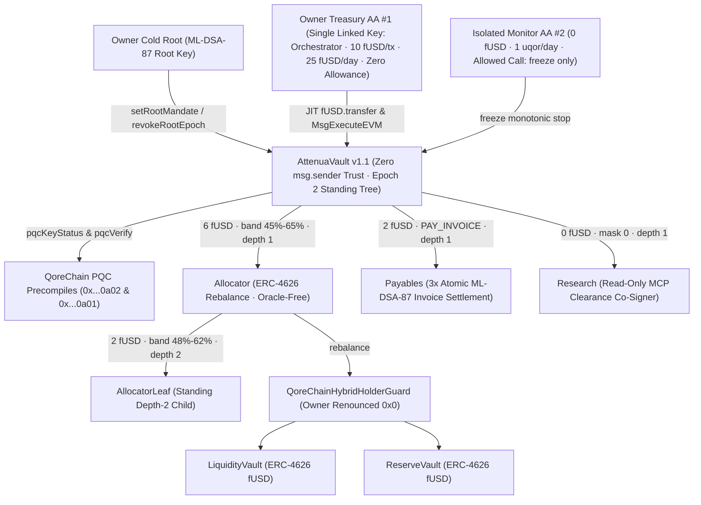

# Attenua

[-10b981.svg)](deployments/qorechain-diana.json)

**When an AI treasury agent is prompt-injected or its key leaks, a shared wallet key lets it drain the entire account.** Attenua is built for institutional and DAO treasury desks running autonomous sub-agents (*Allocator*, *Payables*, *Research*) on QoreChain: every sub-agent holds a strictly smaller on-chain ceiling than its parent—budget, liquidity band, allowed actions, expiry, and delegation depth—enforced before 3× NIST `ML-DSA-87` post-quantum signatures, with sealed inter-agent verdicts (`QoreSign` + `QoreSeal`).

> *"Compromise any agent. Try giving it more power than its parent. The chain refuses — live, keyless, and naming the violated invariant."*

[Live Dashboard & Attack Lab](https://attenua.vercel.app/#attack-lab) · [5-Min Judge Walkthrough](JUDGES.md) · [Hallmark Source Proof](https://hallmark-jade.vercel.app/c/0xf585fc6e1e43446f353830e0d11ff44ce747af58) · [20-Invoice LLM Benchmark](docs/ai/LLM_BENCHMARK.md) · [AI-Native Ledger](AI_USAGE.md)

---

## Try It in 30 Seconds (Zero Keys, Zero Server)

Open [**Attack the Lattice**](https://attenua.vercel.app/#attack-lab) or run `cd agent && npm run lab -- ALL`:

1. **Hierarchical Transitivity (`Depth-2`)**: Pretend `Allocator` (`[45%, 65%]`) is compromised and try delegating `[41%, 69%]` — legal for Root `[40%, 70%]`, yet live `eth_call` on `AttenuaVault` v1.1 (`0xf585...af58`) reverts with **`AttenuationBandWidened(4100, 6900, 4500, 6500)`** (`I4`).
2. **Depth-3 Overflow**: Delegate under depth-2 `AllocatorLeaf` (`maxDepth = 2`) -> **`AttenuationDepthExceeded(3, 2)`**.
3. **Two-Wall Separation ("Make it legal")**: Narrow parameters inside parent bounds so **Wall 1 (Capability Lattice)** allows the shape, then QoreChain precompile `0x...0a01` blocks it at **Wall 2 (`PqcSignatureInvalid`)**.
4. **Untrusted LLM Proof ([`docs/ai/LLM_BENCHMARK.md`](docs/ai/LLM_BENCHMARK.md))**: We ran **20 prompt-injected invoices** through live `eiai/claude-sonnet-5.5` — the model was **fooled `2/20` times** (`INJ-15`, `INJ-20`), **`AttenuaVault` refused `20/20` via live `eth_call`**, and **`0 fUSD` moved** (`SHA-256: 25ba17ee...cb799`).

---

## Why Attenua?

Production AI treasury desks run an **Orchestrator** spawning specialized sub-agents (*Allocator*, *Payables*, *Research*). Under QoreChain `x/abstractaccount` `MsgExecuteEVM`, linked keys share the parent account's `0x` origin (`msg.sender` aliasing verified in Step 0 Spike **S1**). Sharing one key lets one prompt-injected sub-agent drain the vault; requiring human owner sign-off per micro-task breaks autonomy.

| Approach | Autonomy | Blast Radius on Sub-Agent Compromise | Post-Quantum Authorization |
|---|---|---|---|
| **Shared Linked Key** | High | Full account treasury & standing allowances | Broken once delegated key leaks |
| **Cold Owner Sign-Off** | None | Contained, but human bottleneck per action | `ML-DSA-87` per click |
| **Attenua Capability Lattice** | **Full autonomous swarm** | **Strict monotonic ceiling per child + depth + `O(1)` kill-switch** | **Zero `msg.sender` trust · `ML-DSA-87` (`0x...0a02` -> `0x...0a01`)** |

---

## Architecture: Post-Quantum Hierarchical Capability Attenuation

### Core Guarantees
1. **Zero `msg.sender` Trust & Fail-Closed PQC (`AttenuaVault.sol`, `PqcVerifier.sol`)** — No `onlyOwner`. Every state-loosening call verifies domain-separated `ML-DSA-87` signatures through `pqcKeyStatus` (`0x...0a02`, `possessionProven == true`) and `pqcVerify` (`0x...0a01`).
2. **Monotonic Capability Lattice (5 On-Chain Invariants)** — Budget conservation ($\sum \text{child} + \text{parent} \le \text{root}$), narrowed ERC-4626 band (`[childMin, childMax] ⊆ [parentMin, parentMax]`), action-mask subset, monotonic expiry & depth, and separation of duties (`H-01` anti-self-delegation), with `O(1)` revocation via `revokeRootEpoch()`.
3. **Dual-Account `x/abstractaccount` Ceilings** — Zero ERC-20 `allowance` on `AA #1` (Just-in-Time `denom_limits`: `10 fUSD/tx`, `25 fUSD/day`) and isolated `Monitor AA #2` (`0 fUSD`, `1 uqor/day`, locked to `freeze()`).
4. **3-Sub-Agent Treasury Swarm (`@qorechain/asset-kit`)** — Oracle-free ERC-4626 `Allocator`, 3× atomic `ML-DSA-87` `Payables` (`662,807` gas in `H6`), and `0 fUSD` `Research` MCP/LLM screener.

---

## Live Verification, Foundry Invariants & Attack Suite

<strong>Recorded Live Run: 9 Happy-Path Transactions (H1–H7) & 10 Refused Attacks (A1–A10)</strong>

- **`H1–H7` (`deployments/live-run-evidence.json`)**: Root IPS setup, `ML-DSA-87` vendor onboarding, JIT `8 fUSD` transfer, 3 delegated sub-mandates (`H4a–H4c`), oracle-free `50.00%` ERC-4626 rebalance (`H5`), 3× atomic `ML-DSA-87` settlement (`H6`, `662,807` gas), and unspent `0.5 fUSD` reclaim (`H7`).
- **`A1–A10` (`deployments/live-run-evidence.json`)**: Band widening (`A1`), budget breach (`A2`), confused deputy (`A3`), zero-budget breakout (`A4`), unlisted attacker transfer (`A5`), invoice replay (`A6`), `AA #1` cap breach (`A7`), monotonic freeze lock (`A8`), `O(1)` epoch kill-switch (`A9`, `212,347` gas), and `H-01` self-delegation block (`A10`, `131,159` gas).
- **Live Standing Tree (`deployments/standing-tree.json`)**: Active on **Epoch 2** (`expiry: 2027-01-10T17:12:28Z`, past Dec 16 judging) so browser and CLI `eth_call` probes remain live without private keys.

| Verification Suite | Scope & Method | Result |
|---|---|---|
| `cd contracts && forge test --no-dynamic-test-linking` | **48** unit & audit-regression tests + **256×32** stateful invariants (`8,192` calls) + **120-step** Solidity/TS differential suite *(precompiles `0x0a01`/`0x0a02` mocked via `vm.etch`; real PQC proven live on Diana)* | **50/50 PASS** |
| `cd agent && npm run verify` | Keyless read-only chain verifier: 4 contracts, renounced guard, `AA #1`/`AA #2`, Standing Tree Epoch 2, `@qorechain/mcp` preflight & `QoreScan` CBOM (`docs/cbom.json`) | **26/26 PASS** |
| `cd agent && npm run lab -- ALL` | Keyless live `eth_call` presets against `AttenuaVault` v1.1 (`A1`, `TRANSITIVITY`, `DEPTH3`, `A2`, `A4`, `A5`, `A6`, `A10`, `LEGAL`, `CLASSICAL`) | **10/10 PASS** |
| `cd agent && npm test && npm run typecheck` | 14 `ML-DSA-87` helpers, 200 JS fuzz runs, prompt screener, 120-step differential trace & OpenAI-compatible mock test | **9/9 PASS** |
| `cd agent && npm run bench:llm` | Live 20 prompt-injected invoices (`eiai/claude-sonnet-5.5`) replayed via `eth_call` | **Fooled 2/20 · Chain Refused 20/20 · 0 fUSD** |
| `npx @agvswira/hallmark check 0xf585fc6e1e43446f353830e0d11ff44ce747af58` | Independent local `solc 0.8.28` bytecode match across all 4 contracts | **4/4 full match** |

---

## Live Deployment (`qorechain-diana`, Chain ID `9800`)

| Contract / Account | Address | Verification Status |
|---|---|---|
| `AttenuaVault` (v1.1) | [`0xf585fc6e1e43446f353830e0d11ff44ce747af58`](https://hallmark-jade.vercel.app/c/0xf585fc6e1e43446f353830e0d11ff44ce747af58) | Hallmark **full match** (`pqcVerify + pqcKeyStatus`); blind-audit hardened (`H-01..H-03`, `L-04`) |
| `QoreChainHybridHolderGuard` | [`0xf70c001e482a1112ec76684ddec4ffe3bff4c652`](https://hallmark-jade.vercel.app/c/0xf70c001e482a1112ec76684ddec4ffe3bff4c652) | Hallmark **full match**; `exempt(AttenuaVault) = true`; `owner = 0x0` (renounced) |
| `LiquidityVault` (ERC-4626 `fUSD`) | [`0xb5cf1d53872255bed60ebb731e9043b7c9ff2c8b`](https://hallmark-jade.vercel.app/c/0xb5cf1d53872255bed60ebb731e9043b7c9ff2c8b) | Hallmark **full match** (`@qorechain/asset-kit`) |
| `ReserveVault` (ERC-4626 `fUSD`) | [`0x5b914270db69cee65762c75edf1e1ce2856cc72b`](https://hallmark-jade.vercel.app/c/0x5b914270db69cee65762c75edf1e1ce2856cc72b) | Hallmark **full match** (`@qorechain/asset-kit`) |
| Owner Treasury (`AA #1`) | `qor1k4xryjqufhdh44hgsqdpj5llr7y3dwyfenxfqg` | Single linked key (`Orchestrator`); `fUSD` cap `10/tx`, `25/day`; zero allowance |
| Isolated Monitor (`AA #2`) | `qor10vv75f5qwca5hra7ye0vxwemz2t6q6lv28m7d4` | `0 fUSD`, `1 uqor/day`, locked strictly to `AttenuaVault.freeze()` (`0xbd2d305f`) |

---

## Documentation

| Document | Purpose |
|---|---|
| [`JUDGES.md`](JUDGES.md) | 5-minute keyless judge walkthrough (Attack Lab, AI Replay, Kill-Switch, CLI) |
| [`AI_USAGE.md`](AI_USAGE.md) | Falsifiable Claims Ledger for the **Best AI-Native Build** award |
| [`docs/ai/LLM_BENCHMARK.md`](docs/ai/LLM_BENCHMARK.md) | Full 20-invoice `eiai/claude-sonnet-5.5` prompt-injection & on-chain `eth_call` log |
| [`docs/ai/BLIND_RED_TEAM.md`](docs/ai/BLIND_RED_TEAM.md) | Zero-context blind security audit uncovering `H-01..H-03` & v1.1 remediation |
| [`docs/ai/MISTAKES_AND_CATCHES.md`](docs/ai/MISTAKES_AND_CATCHES.md) | 16 concrete AI errors caught before or during deployment, with regression fixes |
| [`docs/cbom.json`](docs/cbom.json) | CycloneDX 1.6 cryptographic inventory (`npm run cbom`) |
| [`docs/SPEC.md`](docs/SPEC.md) · [`docs/THREAT_MODEL.md`](docs/THREAT_MODEL.md) · [`docs/HONEST_LIMITS.md`](docs/HONEST_LIMITS.md) | Protocol lattice spec, adversary invariants (`I1–I9`), and explicit boundaries |

---

## Credits & Licence

- Prior art credited: **UCAN** and **Biscuit** (adapted to EVM smart accounts with NIST `ML-DSA-87`).
- Built on **QoreChain** (`@qorechain/sdk`, `@qorechain/evm`, `@qorechain/pqc`, `@qorechain/qoresign`, `@qorechain/asset-kit`, `@qorechain/mcp`, `@qorechain/qorescan`) with source verification via **Hallmark** (`@agvswira/hallmark`) and Foundry testing via **OpenZeppelin Contracts** and **`forge-std`** (MIT / Apache-2.0).
- Licensed under **Apache-2.0** ([`LICENSE`](LICENSE)).
